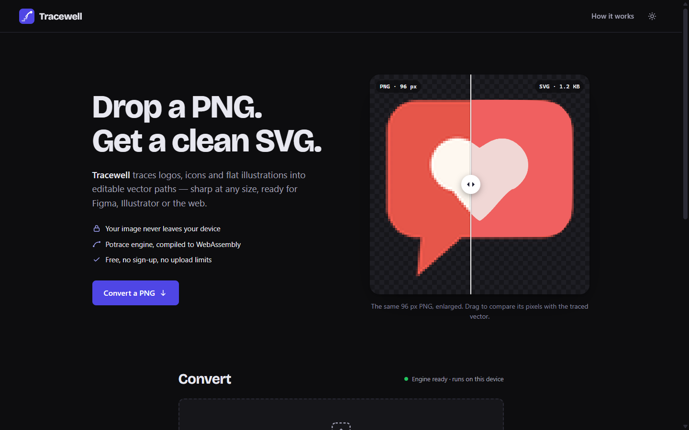
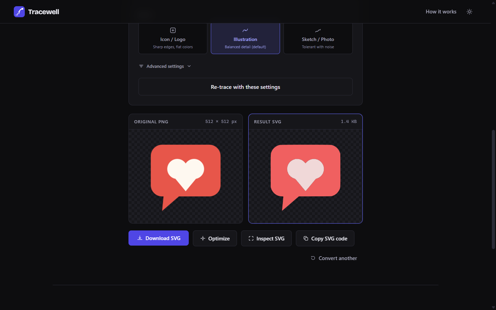
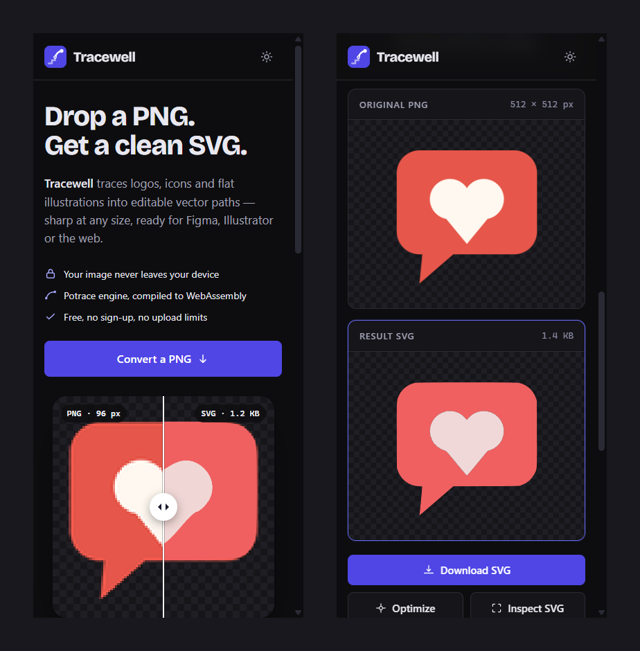

<p align="center">
  
</p>

<h1 align="center">Tracewell</h1>

<p align="center">
  <strong>Drop a PNG, get a clean SVG.</strong><br>
  A private, in-browser vectorizer for logos, icons and flat illustrations.
</p>

<p align="center">
  <a href="https://pablo-guarachi.github.io/tracewell/"><strong>Live demo</strong></a> ·
  <a href="#how-it-works">How it works</a> ·
  <a href="#license">License</a>
</p>



## What it does

Tracewell turns raster images (PNG) into **real vector paths** (SVG) that stay sharp at any size and can be
edited in Figma, Illustrator, Inkscape or straight in code. Everything happens in your browser tab:
**the image is never uploaded anywhere**, there is no server and no account.

| Converter | On a phone |
|---|---|
|  |  |

## Features

- **Drag-and-drop, file picker or one-click samples** — try it without having a PNG at hand.
- **Three presets** (Icon / Logo, Illustration, Sketch / Photo) plus advanced Detail and Smoothing controls.
- **Colour or black-and-white tracing**, with a warning for very large images.
- **Side-by-side preview**, file size, one-click **download** or **copy SVG code**.
- **Optimize**: removes degenerate micro-paths and rounds coordinates.
- **Inspector**: full-screen zoom/pan on checkerboard, white or black, and a **code editor** with live preview —
  select paths, recolour with flat fills or gradients sampled from the original PNG, add background layers,
  apply SVG filter effects (glow, shadow, outline, …).
- **Clear states**: engine loading / ready / unavailable (with retry), wrong file type, unreadable PNG, large file.
- **Accessible**: WCAG AA contrast in both themes, visible focus, keyboard-operable drop zone and comparison slider,
  44 px touch targets, live-region announcements. Dark and light themes.

## How it works

1. **Read the pixels.** The PNG is drawn on a `<canvas>` in the page; nothing leaves the device.
2. **Split into colour layers.** A median-cut quantizer builds a small palette, similar colours are merged,
   and each colour becomes a black-and-white mask (lightly blurred so edges trace as curves, not stairs).
3. **Trace every layer.** [Potrace](https://potrace.sourceforge.net/), compiled to WebAssembly
   ([potrace-wasm](https://github.com/IguteChung/potrace-wasm)), fits Bézier curves to each mask.
   The layers are stacked into a single SVG.

**Stack:** vanilla HTML, CSS and JavaScript — no framework, no bundler, no build step.

```
index.html     page structure (hero, converter, inspector)
style.css      design tokens + components (dark/light)
app.js         conversion pipeline, optimizer, inspector/editor
ui.js          presentation layer: name, before/after slider, samples, engine status, announcements
samples.js     sample PNGs embedded as data URIs (generated by scripts/embed-samples.py)
examples/      sample images and the hero's before/after files
```

## Run it locally

It is a static site. Either open `index.html` directly in a browser, or serve the folder:

```bash
npx serve .          # or: python -m http.server 8000
```

An internet connection is needed the first time to fetch the tracing engine from the `esm.sh` CDN.

**Deploy:** the included GitHub Actions workflow (`.github/workflows/deploy.yml`) publishes the repository root to
GitHub Pages on every push to `main` — enable it once under *Settings → Pages → Source → GitHub Actions*.

## Privacy

No uploads, no analytics, no cookies. The only network requests are the page itself and the potrace-wasm module
from `esm.sh`. Your theme choice is stored in `localStorage`.

## Known limitations

- Colour fidelity depends on the palette step: some colours shift slightly (try the *Icon / Logo* preset or more
  Detail). Photos and gradients are not a good fit for tracing.
- Very large images (> 3000 px) trace on the main thread and can freeze the tab for a few seconds.
- The inspector's code editor is designed for desktop; on phones it stacks vertically and works best for viewing.

## License

The application code in this repository is released under the [MIT License](LICENSE).

The tracing engine, **Potrace** (© Peter Selinger) and its WebAssembly port **potrace-wasm**, is licensed under the
**GPL-2.0**. It is not included in this repository: the browser loads it at runtime from a CDN. If you bundle or
self-host potrace-wasm, the combined work must follow the GPL.

The display font **Bricolage Grotesque** is used under the SIL Open Font License 1.1 (`assets/fonts/OFL.txt`).

## Credits

Designed and directed by me, with AI-assisted development using
[Claude Code](https://claude.com/claude-code): I set the requirements, the tracing approach and the design direction, and reviewed and tested the result; the assistant wrote most of the code, the UI implementation and the docs.
